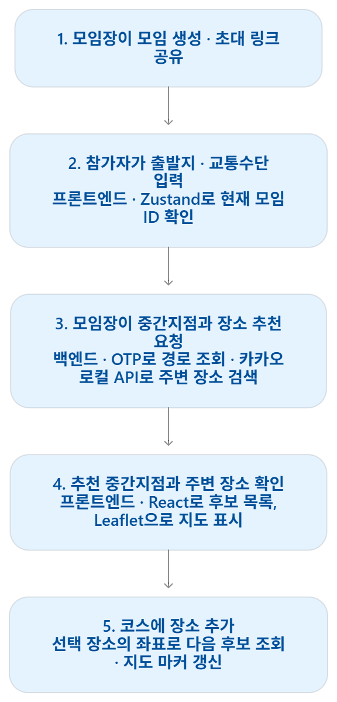

# 프로젝트명: 미드미트

서로 다른 지역에서 출발하는 사람들이 모임 장소를 정할 때, 지도에서 중간쯤에 있는 장소라도 출발지와 교통수단에 따라 이동시간은 달라집니다. 미드미트는 참가자별 예상 이동시간을 비교해 모임 장소를 추천하고, 주변 장소를 골라 모임 코스를 구성할 수 있는 웹서비스입니다.

| 항목 | 내용 |
| --- | --- |
| 개발 기간 | 6개월 |
| 팀 규모 | 4명 |
| 개발 상태 | 개발 완료 |
| 담당 역할 | 서비스 기획 참여 및 프론트엔드 전체 설계·구현 |

## 맡은 역할

4인 팀에서 프론트엔드와 백엔드로 역할을 나눴습니다. 저는 서비스 기획에 참여하고 프론트엔드 전체를 맡았습니다. 
모임장이 초대 링크를 공유하고, 참가자가 출발지와 교통수단을 입력한 뒤, 추천 중간지점을 지도에서 확인하고 주변 장소로 코스를 구성하는 흐름을 설계하고 구현했습니다.

## 서비스 흐름과 주요 기술

서로 다른 지역에서 출발하는 친구들이 모인다고 가정했습니다. 모임장이 초대 링크를 공유한 뒤, 참가자가 각자의 출발지와 교통수단을 입력하면 다음 흐름으로 모임 장소를 추천하고 코스를 구성할 수 있습니다.

  

1. **초대 링크로 참여할 때 · React와 Zustand**  
   초대 링크로 들어온 참가자가 출발지 주소와 교통수단을 입력하는 화면을 구현했습니다. 제출할 때는 Zustand에서 현재 모임 ID를 가져오고, 폼에서 받은 주소와 교통수단을 해당 모임의 참여 API에 보냈습니다. [참가 정보 제출 코드](https://github.com/chohyeonK/midmeet-frontend/blob/master/src/pages/party/JoinInput.tsx#L12-L48)

2. **중간지점과 주변 장소를 추천할 때 · OpenTripPlanner(OTP)와 카카오 로컬 API**  
   모임장이 추천 화면을 열면 프론트엔드는 백엔드에 중간지점과 장소 후보를 요청합니다. 중간지점 계산이 필요한 경우 백엔드는 OTP로 참가자별 이동 가능 영역을 조회합니다. 공통 영역 안의 지하철역을 후보로 추리고, OTP에서 조회한 역별 이동시간을 비교해 참가자 간 편차가 작은 역을 선정합니다. 백엔드는 선정된 중간지점 주변의 장소를 카카오 로컬 API로 검색해, 중간지점 좌표와 함께 프론트엔드에 반환합니다. [추천 결과 API](https://github.com/skand406/midmeet-backend/blob/master/src/party/party.controller.ts#L830-L1029) · [중간지점 선정 코드](https://github.com/skand406/midmeet-backend/blob/master/src/party/services/otp/otp.service.ts#L218-L344) · [카카오 장소 검색 코드](https://github.com/skand406/midmeet-backend/blob/master/src/party/services/kakao/kakao.service.ts#L17-L119)

3. **추천 결과를 보고 코스를 구성할 때 · React와 Leaflet**  
   백엔드에서 받은 주변 장소 후보를 React 목록에 표시하고, 중간지점과 선택한 코스 장소의 좌표로 Leaflet 마커를 구성했습니다. 코스 마커에 방문 순서대로 번호를 붙이고, 표시할 지점이 바뀌면 `fitBounds`로 지도 중심과 확대 수준을 맞췄습니다. 직접 코스를 구성할 때는 다음 단계의 추천 목록이 없으면 현재 선택한 장소의 좌표를 백엔드의 코스 후보 조회 API에 보냅니다. 백엔드는 그 좌표를 기준으로 카카오 로컬 API에서 장소를 검색하고, 프론트엔드는 반환된 후보로 다음 단계의 목록을 채웁니다. [마커 데이터 구성](https://github.com/chohyeonK/midmeet-frontend/blob/master/src/components/midpoint/MidContainer.tsx#L149-L252) · [지도 범위 조정](https://github.com/chohyeonK/midmeet-frontend/blob/master/src/components/midpoint/Map.tsx#L46-L84) · [프론트엔드 후보 조회 코드](https://github.com/chohyeonK/midmeet-frontend/blob/master/src/pages/midpoint/MidFinding.tsx#L212-L252) · [백엔드 코스 후보 API](https://github.com/skand406/midmeet-backend/blob/master/src/party/party.controller.ts#L1034-L1090)

## 프론트엔드 기술 사용 경험

| 기술 | 사용한 곳 |
| --- | --- |
| React · TypeScript · Tailwind CSS | 모임 생성, 참가자 입력, 코스 구성과 결과 화면을 구현했습니다. 코스와 장소 데이터는 TypeScript 타입으로 정의했습니다. |
| Leaflet · React Leaflet | 추천 중간지점과 코스 장소를 마커로 표시하고 지도 범위를 조정했습니다. |
| Zustand | 초대 링크로 참여하는 과정에서 참가자 입력 화면까지 모임 ID를 공유했습니다. |
| REST API · Axios | 참가자 정보를 전송하고, 중간지점과 장소 후보를 받아 지도와 목록에 반영했습니다. |

## 사용자 흐름 테스트

위 시나리오에서 제가 모임장이 되어 모임을 만들고 초대 링크를 공유했습니다. 참가자별 정보 입력을 마친 뒤 모임 결과 화면이 표시되는 것까지 확인했습니다.

**모임 생성 → 초대 링크 공유 → 참가자별 정보 입력 → 결과 화면 표시**

## 배운 점과 다음 행동

모임장과 참가자의 화면을 이어서 확인하면서, 여러 역할이 참여하는 서비스에서는 각 화면의 동작과 함께 참가자가 입력한 정보가 같은 모임의 결과 화면까지 이어지는지도 검증해야 한다는 점을 배웠습니다. 다음에는 이 시나리오를 자동화 테스트로 옮겨, 화면이나 API 연동을 수정했을 때도 같은 흐름을 반복해서 확인할 수 있도록 하겠습니다.

중간지점 결과가 표시되기까지 대기가 길었고, 응답 시간은 별도로 측정하지 않았습니다. 개선에 앞서 같은 출발지와 교통수단으로 반복 실행해 **API 요청부터 응답까지 걸린 시간**과 **응답을 받은 뒤 결과가 화면에 표시되기까지 걸린 시간**을 각각 기록하겠습니다.

## 관련 링크

- [미드미트 프론트엔드 저장소](https://github.com/chohyeonK/midmeet-frontend)
- [미드미트 백엔드 저장소](https://github.com/skand406/midmeet-backend)
