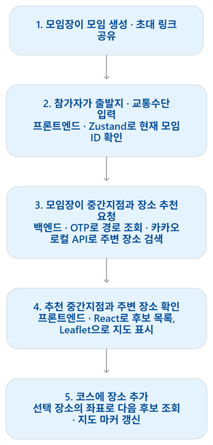

# 프론트엔드 개발 포트폴리오

사용자가 입력한 정보가 결과 화면까지 이어지는 흐름을 설계하고 구현하는 데 관심이 있습니다. 미드미트에서는 모임장이 초대 링크를 공유하고, 참가자가 출발지와 교통수단을 입력한 뒤, 추천 결과를 지도에서 확인하는 흐름을 설계하고 구현했습니다.

## 프로젝트명: 미드미트

미드미트는 여러 지역에서 출발하는 사람들이 교통수단별 예상 이동시간을 고려해 모임 장소를 정하고, 주변 장소를 골라 모임 코스를 구성하는 웹서비스입니다.

| 항목 | 내용 |
| --- | --- |
| 개발 기간 | 6개월 |
| 팀 규모 | 4명 |
| 개발 상태 | 개발 완료 |
| 담당 역할 | 서비스 기획 참여 및 프론트엔드 전체 설계·구현 |

### 서비스 흐름

서로 다른 지역에서 출발하는 친구들이 모인다고 가정했습니다. 모임장이 초대 링크를 공유한 뒤, 참가자가 각자의 출발지와 교통수단을 입력하면 다음 흐름으로 모임 장소를 추천하고 코스를 구성할 수 있습니다.

### 프론트엔드 기술 스택

- **화면 구현** · React, TypeScript, Tailwind CSS
- **상태 관리** · Zustand
- **API 연동** · Axios, REST API
- **지도 시각화** · Leaflet, React Leaflet
- **빌드 도구** · Vite

### 맡은 역할

4인 팀에서 서비스 기획에 참여하고 **프론트엔드 전체의 화면 설계·구현과 API 연동**을 맡았습니다. 백엔드에 전달할 참가자 정보를 입력받는 화면을 설계하고, 초대 링크를 통한 모임 참여부터 추천 결과 확인과 코스 구성까지 구현했습니다.

#### 1. 참가자 입력 화면 설계와 참여 API 연동

- 출발지 주소와 교통수단을 입력하는 **React 폼**을 설계하고 구현했습니다.
- 폼을 제출할 때 **Zustand**에서 모임 ID를 가져오고, 입력값을 해당 모임의 참여 API로 전송하도록 연결했습니다.

[참가 정보 제출 코드](https://github.com/chohyeonK/midmeet-frontend/blob/master/src/pages/party/JoinInput.tsx#L12-L48)

#### 2. 추천 API 응답을 화면 상태로 구성

- 모임장이 추천 화면을 열면 **Axios**로 백엔드 REST API에 중간지점과 장소 후보를 요청하도록 연결했습니다.
- API 응답에서 중간지점 좌표가 담긴 **모임 정보**, **코스**, **장소 후보**를 꺼내 각각 React 상태로 관리했습니다.
- 화면에서 사용하는 코스와 추천 장소의 데이터 구조는 **TypeScript** 타입으로 정의했습니다.

[프론트엔드 추천 요청과 응답 처리](https://github.com/chohyeonK/midmeet-frontend/blob/master/src/pages/midpoint/MidFinding.tsx#L128-L189)

백엔드는 **OpenTripPlanner(OTP)** 서버에서 이동 가능 영역과 후보역까지 걸리는 시간을 조회해 참가자 간 이동시간 편차가 작은 역을 선정합니다. 이후 **카카오 로컬 API**로 주변 장소를 검색해 중간지점 좌표와 함께 반환합니다. [백엔드 추천 결과 API](https://github.com/skand406/midmeet-backend/blob/master/src/party/party.controller.ts#L830-L1029) · [중간지점 선정](https://github.com/skand406/midmeet-backend/blob/master/src/party/services/otp/otp.service.ts#L218-L344) · [카카오 장소 검색](https://github.com/skand406/midmeet-backend/blob/master/src/party/services/kakao/kakao.service.ts#L17-L119)

#### 3. 추천 결과 지도 시각화와 코스 선택 구현

- 주변 장소 후보를 **React 목록**에 표시하고, 선택한 장소를 코스에 추가할 수 있게 구현했습니다.
- 중간지점과 선택한 장소의 좌표를 마커 데이터로 구성하고 **React Leaflet**으로 지도에 표시했습니다. 코스 방문 순서를 마커 번호로 표시하고, 마커 목록이 바뀌면 Leaflet의 `fitBounds`로 지도 범위를 조정했습니다.
- 다음 코스 단계로 이동할 때 **해당 단계의 후보 목록이 저장돼 있으면 재사용**했습니다. 저장된 목록이 없고 선택한 장소가 있으면 그 장소의 좌표로 후보를 요청하고, 응답 목록을 단계 번호에 맞춰 저장했습니다.

[마커 데이터 구성](https://github.com/chohyeonK/midmeet-frontend/blob/master/src/components/midpoint/MidContainer.tsx#L149-L252) · [지도 범위 조정](https://github.com/chohyeonK/midmeet-frontend/blob/master/src/components/midpoint/Map.tsx#L46-L84) · [프론트엔드 후보 조회](https://github.com/chohyeonK/midmeet-frontend/blob/master/src/pages/midpoint/MidFinding.tsx#L212-L252) · [백엔드 코스 후보 API](https://github.com/skand406/midmeet-backend/blob/master/src/party/party.controller.ts#L1034-L1090)

### 사용자 흐름 테스트

위 시나리오에서 제가 모임장이 되어 모임을 만들고 초대 링크를 공유했습니다. 참가자별 정보 입력을 마친 뒤 모임 결과 화면이 표시되는 것까지 확인했습니다.

**모임 생성 → 초대 링크 공유 → 참가자별 정보 입력 → 결과 화면 표시**

### 배운 점과 다음 행동

모임장과 참가자의 화면을 이어서 확인하면서, 여러 역할이 참여하는 서비스에서는 각 화면의 동작과 함께 참가자가 입력한 정보가 같은 모임의 결과 화면까지 이어지는지도 검증해야 한다는 점을 배웠습니다. 다음에는 이 시나리오를 자동화 테스트로 옮겨, 화면이나 API 연동을 수정했을 때도 같은 흐름을 반복해서 확인할 수 있도록 하겠습니다.

중간지점 결과가 표시되기까지 대기가 길었고, 응답 시간은 별도로 측정하지 않았습니다. 개선에 앞서 같은 출발지와 교통수단으로 반복 실행해 **API 요청부터 응답까지 걸린 시간**과 **응답을 받은 뒤 결과가 화면에 표시되기까지 걸린 시간**을 각각 기록하겠습니다.

### 프로젝트 코드 저장소

- [미드미트 프론트엔드 저장소](https://github.com/chohyeonK/midmeet-frontend)
- [미드미트 백엔드 저장소](https://github.com/skand406/midmeet-backend)
